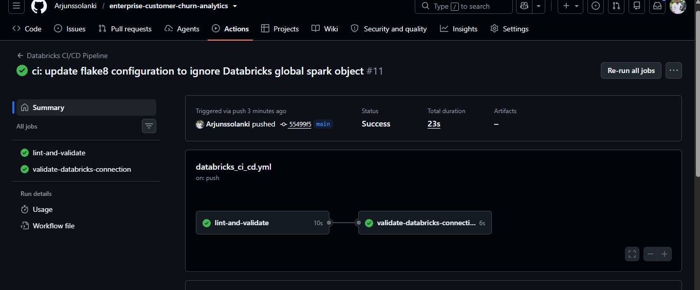
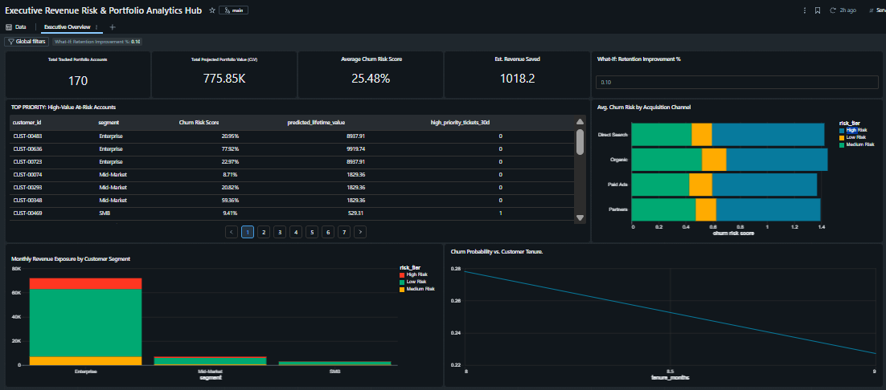

# Enterprise Customer Churn Analytics & Lifetime Value Prediction Platform

An end-to-end, production-grade customer churn and Customer Lifetime Value (CLV) analytics platform built entirely on **Databricks Delta Lake**, **Python Machine Learning (XGBoost)**, and **Databricks Lakeview Dashboards**.

---

## 🌟 Architecture & System Overview

This platform implements a modern **Medallion Lakehouse Architecture** to ingest raw multi-source data, perform advanced feature engineering with time-series window functions, train optimized machine learning models with automated hyperparameter tuning, and deliver real-time operational intelligence to executive and customer success teams.

```
[Raw Sources] ──> [01. Bronze / Schema Setup] ──> [02. Mock Data Seed Engine]
                                                           │
                                                           v
[CI/CD GitHub Actions] <── [04. XGBoost ML Pipeline] <── [03. Gold Feature Store]
                                   │                       (Window Functions / LAG)
                                   v
                         [Lakeview BI Dashboard]
```

---

## 📁 Repository Structure

```text
├── 01_database_infrastructure.sql       # Delta Lake star-schema catalog & base tables
├── 02_populate_mock_data.sql            # Probabilistic production seed engine (1,000+ rows)
├── 03_feature_extraction_pipeline.sql   # Silver-to-Gold aggregation & rolling time-series features
├── 04_model_training_pipeline.py        # XGBoost hyperparameter tuning, dual modeling, & serialization
├── churn_classifier_model.pkl           # Serialized production churn classification pipeline
├── clv_regressor_model.pkl              # Serialized production CLV regression pipeline
├── databricks_ci_cd.yml                 # GitHub Actions workflow for linting & workspace validation
└── requirements.txt                     # Project Python dependencies
```

---

## ⚙️ Core Components Breakdown

### 1. Delta Lake Infrastructure (`01_database_infrastructure.sql`)
* Implements an optimized star-schema under the `customer_churn_analytics` catalog.
* Houses dimension tables (`dim_customers`) and high-volume fact tables (`fact_billing_transactions`, `fact_daily_usage`, `fact_support_tickets`) leveraging native Delta Lake storage for ACID compliance and high-performance querying.

### 2. Probabilistic Mock Data Engine (`02_populate_mock_data.sql`)
* Generates realistic multi-channel enterprise telemetry with built-in data noise.
* Incorporates segment-tiered subscription pricing (SMB, Mid-Market, Enterprise), controlled payment failure rates ($5\%$), and support ticket resolution backlogs.

### 3. Feature Store & Window Engineering (`03_feature_extraction_pipeline.sql`)
* Aggregates monthly billing, platform usage, and support friction metrics.
* Utilizes Spark SQL window functions (`LAG(...) OVER (PARTITION BY ... ORDER BY ...)`) to compute month-over-month engagement velocity (`login_velocity_30d`).
* Encodes complex non-linear boundary conditions to simulate realistic enterprise churn behavior.

### 4. Production Machine Learning & Serialization (`04_model_training_pipeline.py`)
* **Automated Environment Bootstrap:** Programmatically checks and injects required dependencies (`xgboost==2.1.1`).
* **Robust Preprocessing:** Combines `StandardScaler` for numeric features and `OneHotEncoder` for categorical inputs inside scikit-learn `Pipeline` objects to prevent data leakage.
* **Hyperparameter Optimization:** Leverages `GridSearchCV` across `n_estimators`, `max_depth`, and `learning_rate`.
* **Dual Modeling:** Trains an `XGBClassifier` for churn probability alongside an `XGBRegressor` for Customer Lifetime Value (CLV).
* **Artifact Export:** Serializes trained pipelines to disk (`churn_classifier_model.pkl`, `clv_regressor_model.pkl`) and persists scored inference outputs back to Delta Lake.

## ⚙️ Automated CI/CD Pipeline (`.github/workflows/databricks_ci_cd.yml`)

This repository uses **GitHub Actions** for automated code linting, quality assurance, and Databricks authentication validation on every push and pull request.
### 🟢 Pipeline Execution Status



### Pipeline Stages & Workflow Execution
1. **`lint-and-validate` Job:**
   * Sets up Python 3.10 and installs `flake8`.
   * Executes static code analysis, ignoring runtime Databricks PySpark session objects (`spark`) via `--ignore=F821`.
2. **`validate-databricks-connection` Job:**
   * Configures the Databricks CLI (`databricks/setup-cli@main`).
   * Validates workspace parameters (`DATABRICKS_HOST` and `DATABRICKS_TOKEN`) stored securely in GitHub Repository Secrets.

> 🟢 **Verified Status:** Automated workflow executed successfully in **23s** across all linting and authentication validation jobs.

---

## 📊 Model Performance & Evaluation

Evaluated on a held-out test split, the optimized churn classification pipeline achieves:

* **Overall Accuracy:** $79.41\%$
* **Class 0 (Retained Customers):** Precision: $0.83$ | Recall: $0.93$ | F1-Score: $0.88$
* **Class 1 (Churned Customers):** Precision: $0.50$ | Recall: $0.29$ | F1-Score: $0.36$

---

## 🖥️ Databricks Lakeview Executive Dashboard
## 📊 Executive Dashboard Preview

Here is a preview of the **Executive Revenue Risk & Portfolio Analytics Hub** built natively in Databricks Lakeview:


The platform feeds directly into an interactive executive dashboard featuring:
* **Executive Summary KPIs:** Total portfolio accounts, total projected CLV, average churn risk, and estimated revenue saved.
* **Interactive What-If Simulation:** Dynamic slider parameters (`:RetentionImprovement`) enabling leadership to model real-time financial recapturing and long-term portfolio growth.
* **Actionable Account Drill-Downs:** High-priority tables surfacing high-risk enterprise clients to empower customer success intervention before churn occurs.
* **Segment & Channel Analytics:** Visual breakdowns tracking revenue exposure by tier and acquisition channel stability.

---

## 🚀 Getting Started

1. **Clone the repository:**
   ```bash
   git clone https://github.com/your-username/enterprise-customer-churn-analytics.git
   cd enterprise-customer-churn-analytics
   ```
2. **Execute Database & Feature Scripts:**
   Run scripts `01` through `03` sequentially inside your Databricks SQL workspace or notebook environment.
3. **Run Model Training:**
   Execute `04_model_training_pipeline.py` on a Databricks cluster to train models and write scored predictions back to Delta Lake.
4. **Connect Lakeview Dashboard:**
   Point your Databricks Lakeview BI canvas to `customer_churn_analytics.final_predictions_output`.
